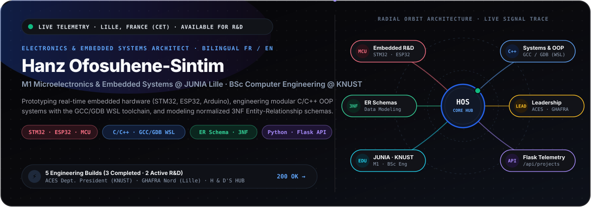
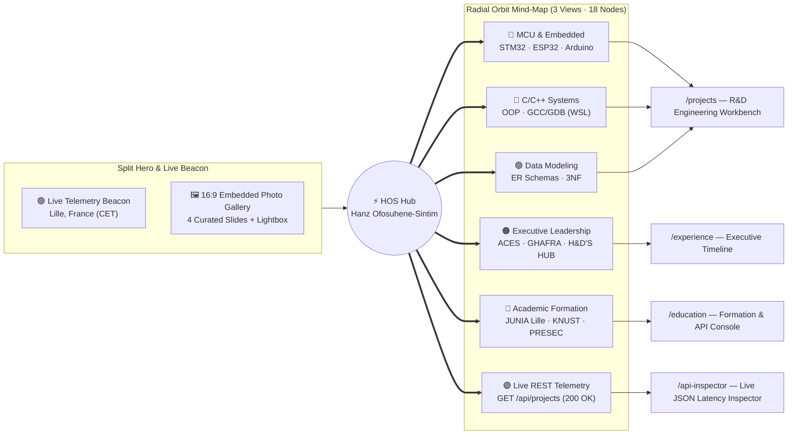

<div align="center">



[](templates/base.html)
[-2563EB?style=for-the-badge)](templates/index.html)
[_%C2%B7_KNUST_(BSc)-0891B2?style=for-the-badge)](templates/education.html)
[](translations.py)

[**⚡ 5 Engineering Projects (2 Active R&D · 3 Completed)**](#-rd-engineering-workbench--systems-catalog) · [**🛠 Core HW/SW Architecture**](#-core-hardware--software-architecture) · [**🏛 Executive Leadership**](#-executive-leadership--venture-operations) · [**🎓 Academic Formation**](#-academic-formation--rd-trajectory) · [**📡 Live JSON API**](#-live-rest-api--local-quickstart)

</div>

---

## 🧭 Interactive Radial Orbit & Application Architecture

This repository powers the bilingual (`FR` / `EN`) engineering portfolio and R&D workbench of **Hanz Ofosuhene-Sintim** (*M1 Microelectronics & Embedded Systems at JUNIA Lille | BSc Computer Engineering at KNUST*).



---

## ⚡ R&D Engineering Workbench & Systems Catalog

> **Interactive Datasheets**: Click any **`➕ Open Engineering Datasheet`** below to inspect its **`[Input] ➔ [Core] ➔ [Output]`** system block diagram, **3-stage R&D milestone pipeline**, **architectural tradeoffs**, and **team acknowledgments** (mirrored live in [`projects.json`](projects.json) and [`templates/projects.html`](templates/projects.html)).

### 🟠 Active R&D Spotlight Track (`in_progress`)

| Code | System & R&D Focus | Core Stack | Milestone Pipeline | Route |
| :--- | :--- | :--- | :--- | :--- |
| **`ROBOT`** | **Autonomous Street-Cleaning Robot Prototype**<br/>*JUNIA Lille · 7-Member M1 Engineering Team* | `STM32` `ESP32` `C/C++` `External AI Camera` `KiCad` | `✓ Stage 1` ➔ **`● Stage 2: MCU Control`** ➔ `○ Stage 3` | [`/projects`](templates/projects.html) |
| **`PORTFOLIO`** | **Bilingual Engineering Portfolio & Project Studio**<br/>*Gallery Alabaster & True OLED Black Architecture* | `Python 3` `Flask` `Jinja2` `JSON API` `SVG/CSS` | `✓ Stage 1` ➔ `✓ Stage 2` ➔ **`● Stage 3: Integration`** | [`/projects`](templates/projects.html) |

<details open>
<summary><strong>➕ Open Engineering Datasheet — 01. Autonomous Street-Cleaning Robot Prototype (JUNIA Lille M1 R&D)</strong></summary>

<br/>

- **Lifecycle Status**: `🟠 In Progress — Active R&D`
- **System Block Diagram**:
  ```mermaid
  flowchart LR
      S1["01 · External AI Camera & Ultrasonic Array"] ==> S2["02 · STM32 / ESP32 Real-Time Control Core"]
      S2 ==> S3["03 · PWM Motor & Sweeper Actuation"]
      S3 ==> S4["04 · Telemetry & Safety Feedback Loop"]
  ```
- **Interactive 3-Stage R&D Milestone Pipeline**:
  1. `✓ DONE` — **Stage 1: Architecture & Sensor Selection**: Defined dual-MCU responsibility split (`STM32` deterministic motor/sensor control + `ESP32` wireless telemetry), power budget, and external AI camera interface for urban Lille pavements.
  2. `● ACTIVE` — **Stage 2: MCU Control**: Developing real-time C/C++ firmware for PWM traction drive, ultrasonic obstacle avoidance interrupts, and UART/I2C camera frame parsing.
  3. `○ UPCOMING` — **Stage 3: Integration**: Full chassis wiring, KiCad PCB power distribution validation, and closed-loop street-sweeping field trials at JUNIA Lille.
- **Engineering Tradeoffs & Design Decisions**:
  - Partitioned vision inference onto an external AI camera module rather than the primary MCU to preserve deterministic real-time interrupt latency on the `STM32` control loop.
  - Selected dual `STM32` + `ESP32` architecture to isolate high-current motor PWM noise from Wi-Fi/BLE telemetry.
- **Team & Collaborators**: Hanz Ofosuhene-Sintim & JUNIA Lille 7-Member M1 R&D Engineering Team.

</details>

<details>
<summary><strong>➕ Open Engineering Datasheet — 02. Bilingual Engineering Portfolio & Project Studio</strong></summary>

<br/>

- **Lifecycle Status**: `🟠 In Progress — Active R&D`
- **System Block Diagram**:
  `[01 · Browser Accept-Language & Cookie Request]` ➔ `[02 · Flask Context Processor & i18n Engine]` ➔ `[03 · JSON Persistence & REST API (/api/projects)]` ➔ `[04 · Bilingual App-Shell & Radial Mind-Map UI]`
- **3-Stage R&D Milestone Pipeline**:
  1. `✓ DONE` — **Stage 1: Architecture & Sensor Selection**: Designed zero-ORM `projects.json` persistence schema, bilingual `FR`/`EN` dictionary structure, and 3-state command rail layout.
  2. `✓ DONE` — **Stage 2: MCU Control**: Implemented Flask routes, localhost Project Studio CRUD endpoints, Global Spotlight Command Palette, and Live Telemetry Beacon.
  3. `● ACTIVE` — **Stage 3: Integration**: Refining `architect-v2` R&D Workbench, interactive milestone pipelines, and live API latency telemetry inspector.
- **Engineering Tradeoffs & Design Decisions**:
  - Chose flat-file atomic JSON persistence (`projects.json`) over SQLite/PostgreSQL to guarantee zero-dependency portability and human-diffable Git version control.
  - Built the Radial Orbit Mind-Map with native SVG Bézier paths and SMIL `<animateMotion>` instead of heavy third-party canvas libraries for zero-bundle-bloat 60fps rendering.

</details>

---

### 🟢 Completed Engineering Systems (`completed`)

| Code | Validated Engineering Build | Core Stack | Architectural Pattern | Route |
| :--- | :--- | :--- | :--- | :--- |
| **`MALL-CPP`** | **C++ Shopping Mall Management System** | `C++` `OOP` `GCC / GDB (WSL)` `CLI` | Polymorphic class hierarchy & deterministic memory | [`/projects`](templates/projects.html) |
| **`ER-3NF`** | **Smart Logistics Relational Database Schema** | `ER Modeling` `Associative Tables` `3NF` `SQL` | M:N resolution & Third Normal Form integrity | [`/projects`](templates/projects.html) |
| **`TANK-MCU`** | **Automatic Water Tank Level Control System** | `Arduino` `Embedded C/C++` `Ultrasonic` `Relay` | Hysteresis threshold state machine | [`/projects`](templates/projects.html) |

<details>
<summary><strong>➕ Open Engineering Datasheet — 03. C++ Shopping Mall Management System (Project Lead)</strong></summary>

<br/>

- **Lifecycle Status**: `🟢 Completed`
- **System Block Diagram**:
  `[01 · Operator CLI & Transaction Input]` ➔ `[02 · C++ OOP Domain Engine (Shops, Inventory, Billing)]` ➔ `[03 · In-Memory Data Structures & Validation]` ➔ `[04 · Persistent File Storage & GDB Verified Output]`
- **Engineering Tradeoffs & Design Decisions**:
  - Engineered pure C++ OOP class hierarchies compiled and debugged via `GCC`/`GDB` on Linux (`WSL`) to enforce strict memory discipline without GUI framework overhead.
  - Separated billing state mutations from catalog lookups to prevent state corruption during multi-item checkout flows.
- **Team & Collaborators**: Hanz Ofosuhene-Sintim (Project Lead) & KNUST Computer Engineering Software Team.

</details>

<details>
<summary><strong>➕ Open Engineering Datasheet — 04. Smart Logistics Relational Database Schema (ER & 3NF)</strong></summary>

<br/>

- **Lifecycle Status**: `🟢 Completed`
- **System Block Diagram**:
  `[01 · Logistics & Fleet Business Rules]` ➔ `[02 · Conceptual Entity-Relationship (ER) Model]` ➔ `[03 · Associative Junction Tables (M:N Resolution)]` ➔ `[04 · Normalized 3NF Relational Schema]`
- **Engineering Tradeoffs & Design Decisions**:
  - Enforced strict Third Normal Form (`3NF`) with dedicated associative junction tables rather than denormalized arrays to eliminate update/deletion anomalies across multi-stop shipments.
  - Indexed composite foreign keys on dispatch-route junction tables for high-throughput query performance.
- **Team & Collaborators**: Hanz Ofosuhene-Sintim & Systems Modeling Team.

</details>

<details>
<summary><strong>➕ Open Engineering Datasheet — 05. Automatic Water Tank Level Control System</strong></summary>

<br/>

- **Lifecycle Status**: `🟢 Completed`
- **System Block Diagram**:
  `[01 · Ultrasonic Distance Sensor (HC-SR04)]` ➔ `[02 · Arduino MCU & Hysteresis Control Logic]` ➔ `[03 · Relay Driver & Submersible Pump Actuation]` ➔ `[04 · Status Indicators & Overflow Protection]`
- **Engineering Tradeoffs & Design Decisions**:
  - Implemented dual-threshold hysteresis bands (`LOW_ON` / `HIGH_OFF`) with acoustic echo debouncing to eliminate relay chatter caused by water surface ripples.
  - Isolated high-voltage pump switching from the `5V` Arduino logic rail via optocoupled relay drivers.
- **Team & Collaborators**: Hanz Ofosuhene-Sintim & Embedded Hardware Lab Partners.

</details>

---

## 🛠 Core Hardware & Software Architecture

| Domain | Technologies, Toolchains & Methodologies |
| :--- | :--- |
| **🔴 Microcontrollers & Embedded** | `STM32` · `ESP32` · `MSP430` · `Arduino` · Real-Time Interrupts · PWM Motor Control · Ultrasonic Telemetry · External AI Camera Integration |
| **🔵 Systems Programming & Toolchains** | `C` · `C++` · Object-Oriented Design (OOP) · `GCC` / `GDB` Debugging under Linux (`WSL`) · Memory & State-Machine Architecture |
| **🟢 Data Modeling & Backend APIs** | Entity-Relationship (`ER`) Diagrams · Associative Junction Tables (`M:N`) · `3NF` Normalization · `Python 3` · `Flask` · `Jinja2` · RESTful JSON APIs |
| **🟠 Hardware CAD & Prototyping** | `KiCad` Schematic Capture & PCB Layout · Relay Isolation · Sensor Signal Conditioning · Hardware Diagnostics & QA |
| **🟣 Bilingual Engineering** | Native/Fluent **English (`EN`)** & **French (`FR`)** cross-border technical execution between **France** and **Ghana** |

---

## 🏛 Executive Leadership & Venture Operations

Full interactive timeline available on [`/experience`](templates/experience.html):

1. **ACES Department President — KNUST** *(Association of Computer Engineering Students, Kumasi, Ghana)*
   - **Flagship Programs**: Directed departmental **Tech Week**, **Codefest 2026** hackathon, and **Faculty Games**.
   - **Digital Media Expansion**: Modernized departmental communications, technical spotlights, and digital media identity.
   - **Student Welfare & Governance**: Official executive representative for `500+` Computer Engineering students before faculty administration.
2. **Strategic Planning & Organizing Lead — GHAFRA Nord** *(Lille, France)*
   - Driving regional strategic roadmaps, community onboarding, and institutional event operations across the Lille metropolitan area (*Hauts-de-France*).
3. **Founder & Commercial Operations — H & D'S HUB & Mobile Hardware Venture**
   - Founded and operated **H & D'S HUB** alongside a commercial mobile hardware import, component diagnostics/QA, and resale enterprise.

---

## 🎓 Academic Formation & R&D Trajectory

Full academic view and embedded API console available on [`/education`](templates/education.html):

- **🇫🇷 JUNIA Lille — Graduate School of Science & Engineering** *(Lille, France)*
  - **Degree**: *M1 Microelectronics & Embedded Systems* *(Active)*
  - **Focus**: STM32/ESP32 firmware, microelectronics, sensor fusion, KiCad PCB design, and the 7-member Autonomous Street-Cleaning Robot R&D prototype.
- **🇬🇭 KNUST — Kwame Nkrumah University of Science & Technology** *(Kumasi, Ghana)*
  - **Degree**: *BSc Computer Engineering*
  - **Focus**: Computer architecture, C++ OOP systems (`GCC`/`GDB` WSL), 3NF ER database schemas, closed-loop Arduino control, and ACES Departmental Presidency.
- **🇬🇭 Presbyterian Boys' Secondary School (PRESEC Legon)** *(Accra, Ghana)*
  - **Program**: *General Science* (*Odadeɛ* — Physics, Advanced Mathematics, Analytical Sciences).

---

<details>
<summary><strong>🇫🇷 Version Française — Résumé Exécutif & Architecture (Cliquer pour déployer)</strong></summary>

<br/>

### Hanz Ofosuhene-Sintim — Ingénieur Électronique & Systèmes Embarqués
- **Formation** : Cycle Ingénieur **M1 Microélectronique & Systèmes Embarqués à JUNIA Lille** (France) | **BSc Computer Engineering à KNUST** (Ghana) | **PRESEC Legon**.
- **R&D Active & Systèmes (`5 Projets`)** :
  1. *Prototype de Robot Autonome de Nettoyage Urbain* (Équipe R&D de 7 élèves-ingénieurs à JUNIA Lille — `STM32`, `ESP32`, `C/C++`, caméra IA externe).
  2. *Portfolio d'Ingénierie Bilingue FR/EN & Project Studio* (`Python 3`, `Flask`, `Jinja2`, `API JSON`).
  3. *Système C++ de Gestion de Centre Commercial* (Chef de projet — POO C++, chaîne `GCC`/`GDB` sous `WSL`).
  4. *Schéma Relationnel de Logistique Intelligente* (Modélisation Entité-Association `ER`, tables associatives et normalisation `3NF`).
  5. *Système Automatique de Régulation de Niveau d'Eau* (`Arduino`, capteur ultrason, hystérésis et relais).
- **Leadership Exécutif** :
  - **Président du Département ACES (KNUST)** : *Tech Week*, *Codefest 2026*, *Faculty Games*, *Digital Media Expansion* et représentation étudiante.
  - **Responsable Planification Stratégique & Organisation — GHAFRA Nord** (Lille, France).
  - **Fondateur & Opérations Commerciales — H & D'S HUB** (Import, diagnostic matériel et revente mobile).

</details>

---

## 📡 Live REST API & Local Quickstart

The application exposes a live JSON telemetry endpoint at `/api/projects` (and an interactive latency console at [`/api-inspector`](templates/api_inspector.html)):

```http
GET /api/projects
GET /api/projects?status=in_progress
GET /api/projects?status=completed
GET /api/projects?slug=autonomous-street-cleaning-robot
```

### Run Locally (Windows PowerShell / Linux / macOS)

```powershell
# 1. Clone the repository & checkout the architect-v2 branch
git clone https://github.com/HanzSintim/Hanz-Portfolio-webisite.git
cd Hanz-Portfolio-webisite
git checkout architect-v2

# 2. Create & activate virtual environment
python -m venv venv
.\venv\Scripts\Activate.ps1   # On Linux/macOS: source venv/bin/activate

# 3. Install dependencies & launch Flask server
pip install -r requirements.txt
python app.py
```

Then open **`http://127.0.0.1:5000`** in your browser.
